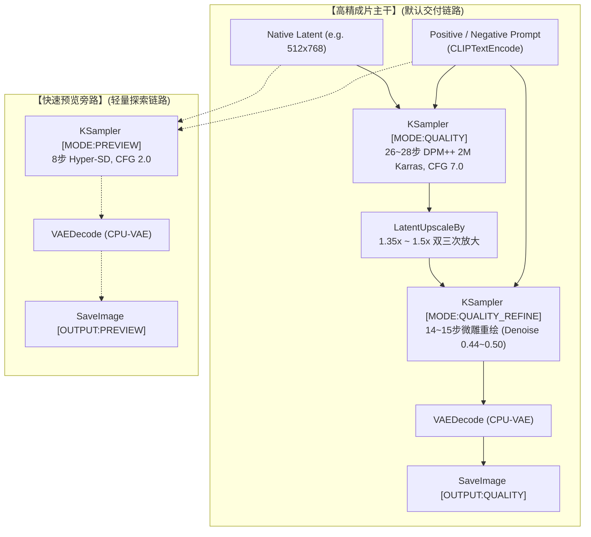

# 🤖 ComfyUI 工业级双轨工作流 Agent 调度使用指南 (Machine-Readable Contract)

> **适用对象**：自主代码大模型（LLM Agent，包括 Google Antigravity, Anthropic Claude, OpenAI Codex/ChatGPT, OpenCode, AutoGPT 等）。  
> **核心目标**：使 Agent 能够零摩擦、程序化地控制本地 ComfyUI 服务端，按需调度 17 套经过严格质量巡检与双轨标准化的工作流，生成工业级高画质图像，并具备全套自愈防御能力。

---

## 一、 Agent 核心执行契约 (Executive Principles)

1. **质量绝对优先原则 (Quality-First Invariant)**：
   - 用户明确指示：“**只保留一个快速抽卡生图的工作流（04 号），其他的都要以确保质量为前提，杜绝差图**”。
   - 当人类用户未显式要求“快速粗览/草图”时，Agent **必须默认调度【高精主干】（`[MODE:QUALITY]` 与 `[OUTPUT:QUALITY]`）**。
   - 严禁将 8 步蒸馏（Hyper-SD）直接作为最终交付成片交付给用户。
2. **纯本地无损通信 (Local API Loop)**：
   - 默认服务地址：`http://127.0.0.1:8284`（可通过环境变量 `COMFYUI_PORT` 自适应）。
   - Agent 与 ComfyUI 之间的一切交互均通过标准 REST HTTP API（`/prompt`, `/history`, `/view`, `/queue`, `/interrupt`）完成，无需模拟浏览器点击。
3. **二次元防模糊红线 (Anti-Blur Cel-Shading Rule)**：
   - 在调度二次元风格（WF05~12, 17）时，**绝对禁止混入真人写实 LoRA（如 `KoreanDollLikeness`）**。
   - 负向提示词必须显式注入：`oil painting, painterly, brush strokes, blurry, soft edges`；
   - 正向提示词推荐置顶强化：`(sharp clean anime lineart:1.35), (crisp 2D cel shading:1.3)`。

---

## 二、 双轨拓扑架构与调度逻辑

每个生成类工作流在拓扑上均具备“主路成片”与“旁路预览”双轨设计：



### 调度决策表 (Decision Table)

| 用户意图场景 | Agent 调度动作 | 目标工作流 | 执行链路 |
| :--- | :--- | :--- | :--- |
| **标准日常出图 / 最终交付成片** | 依据风格匹配对应工作流 | WF01, 02, 06~12, 15~17 | 执行至 `[OUTPUT:QUALITY]` |
| **快速抽卡 / 盲盒灵感探索** | 调度指定极速探索流 | **`04_极速抽卡_无限多风格探索流`** | 执行单轨极速探索 |
| **对话式多轮预览 / 构图确认** | 仅生成粗览样张供快速选择 | 任一生成流 | 仅执行至 `[OUTPUT:PREVIEW]` 节点 |
| **已有图片修补 / 局部重绘** | 传入图像与遮罩 (Mask) | `13_实用工具_局部重绘` | 26 步 DPM++ 重绘 (Denoise 0.65) |
| **姿态骨骼线稿约束生图** | 传入骨骼图或线稿 | `14_精准控制_ControlNet` | OpenPose / Canny 约束双轨微雕 |
| **分析反推参考图风格与词汇** | 传入待分析参考图 | `03_智能工具_NSFW提示词反推` | 提取中英双轨标签与自然语言 |

---

## 三、 17 套工作流关键节点 ID 注册表 (Node ID Map)

在通过 API 提交动态提示词、随机种子或尺寸调整时，Agent 必须精准定位对应节点 ID：

| 工作流文件前缀 | 正向词 (Node ID) | 负向词 (Node ID) | 尺寸 Latent (Node ID) | 高精采样 1 (Node ID) | 微雕采样 2 (Node ID) | 成片保存 (Node ID) |
| :--- | :---: | :---: | :---: | :---: | :---: | :---: |
| **01_真人写实** | `"3"` | `"4"` | `"5"` | `"6"` (26步) | `"8"` (14步) | `"10"` |
| **02_抓拍视角** | `"4"` | `"5"` | `"6"` | `"7"` (26步) | `"9"` (14步) | `"11"` |
| **03_提示词反推** | 载入图 `"1"` | 排除词 `"2"` | N/A (分析工具) | N/A | N/A | 展示 `"4"`, `"5"` |
| **04_极速抽卡** | `"4"` (随机池) | `"5"` | `"6"` | `"7"` (8步极速) | 无微雕 | `"9"` |
| **05_二次元总控** | `"5"` | `"6"` | `"7"` | `"8"` (26步) | `"10"` (14步) | `"12"` |
| **06_吉卜力手绘** | `"4"` | `"5"` | `"6"` | `"7"` (26步) | `"9"` (14步) | `"11"` |
| **07_新海诚日漫** | `"4"` | `"5"` | `"6"` | `"7"` (26步) | `"9"` (14步) | `"11"` |
| **08_二次元暗黑** | `"4"` | `"5"` | `"6"` | `"7"` (26步) | `"9"` (14步) | `"11"` |
| **09_精细厚涂修女** | `"4"` | `"5"` | `"6"` | `"7"` (26步) | `"9"` (14步) | `"11"` |
| **10_4大主题总控** | 主题词 `"3"`~`"6"` | `"8"` | `"9"` | `"10"` (26步) | `"12"` (14步) | `"14"` |
| **11_材质强化沙箱** | 角色 `"3"`, 材质 `"4"` | `"6"` | `"7"` | `"8"` (26步) | `"10"` (14步) | `"12"` |
| **12_BetterWaifu** | 正向姿态 `"4"` | `"5"` | `"6"` | `"7"` (26步) | `"9"` (14步) | `"11"` |
| **13_局部重绘修图** | 重绘目标 `"5"` | `"6"` | 垫图/遮罩 `"3"`, `"4"`| `"7"` (26步重绘) | N/A | `"9"` |
| **14_ControlNet控制** | 引导词 `"4"` | `"5"` | 骨骼图 `"3"` | `"8"` (26步控制) | `"10"` (14步) | `"12"` |
| **15_生活写实写真** | 场景词 `"3"` | `"4"` | `"5"` | `"6"` (26步) | `"8"` (14步) | `"10"` |
| **16_宽屏风景壁纸** | 风光词 `"3"` | `"4"` | `"5"` (896x512) | `"6"` (26步) | `"8"` (14步) | `"10"` |
| **17_角色三视图** | 设定集词 `"3"` | `"4"` | `"5"` (768x512) | `"6"` (28步) | `"8"` (15步) | `"10"` |

---

## 四、 Agent 程序化调度标准代码范式 (Python SDK)

Agent 可直接调用本仓库附带的 [`scripts/comfy_agent_client.py`](./scripts/comfy_agent_client.py)，或使用如下标准代码块实现自包含调度：

```python
import json
import urllib.request
import urllib.parse
import time
import os

SERVER = "http://127.0.0.1:8284"

def generate_image_for_agent(workflow_json_path: str, prompt_text: str, negative_text: str, seed: int = None) -> str:
    """
    Agent 调度标准函数：加载工作流 -> 注入提示词与随机种子 -> 执行并返回成片本地路径
    """
    if seed is None:
        seed = int(time.time() * 1000) % (2**31)

    # 1. 读取基础工作流 API 模板
    with open(workflow_json_path, "r", encoding="utf-8") as f:
        graph = json.load(f)

    # 2. 动态注入（以通用节点 ID 约定为例）
    for nid, node in graph.items():
        ctype = node.get("class_type")
        # 注入正向词
        if ctype == "CLIPTextEncode" and "positive" in node.get("_meta", {}).get("title", "").lower():
            node["inputs"]["text"] = prompt_text
        # 注入基础采样种子
        if ctype == "KSampler":
            node["inputs"]["seed"] = seed

    # 3. 提交任务至队列
    req_data = json.dumps({"prompt": graph}).encode("utf-8")
    req = urllib.request.Request(f"{SERVER}/prompt", data=req_data, headers={"Content-Type": "application/json"})
    with urllib.request.urlopen(req) as resp:
        res = json.loads(resp.read().decode("utf-8"))
    prompt_id = res["prompt_id"]

    # 4. 轮询直到成片
    start_t = time.time()
    while time.time() - start_t < 600:
        with urllib.request.urlopen(f"{SERVER}/history/{prompt_id}") as hist_resp:
            hist = json.loads(hist_resp.read().decode("utf-8"))
            if prompt_id in hist:
                outputs = hist[prompt_id].get("outputs", {})
                for nid, out_data in outputs.items():
                    if "images" in out_data and len(out_data["images"]) > 0:
                        img_info = out_data["images"][0]
                        fn = img_info["filename"]
                        # 下载图像
                        view_url = f"{SERVER}/view?" + urllib.parse.urlencode({"filename": fn})
                        local_path = os.path.join("./downloads", fn)
                        os.makedirs("./downloads", exist_ok=True)
                        urllib.request.urlretrieve(view_url, local_path)
                        return local_path
        time.sleep(3)
    raise TimeoutError(f"Task {prompt_id} timed out.")
```

---

## 五、 提示词工程规范 (SD 1.5 Prompt Engineering)

Agent 在为用户编写或优化 Prompt 时，必须遵循以下权重法则：

1. **语法结构**：
   - 强调词权重：`(keyword:1.2)` 至 `(keyword:1.35)`。严禁超过 `1.5`，否则会引发画面过度饱和或伪影撕裂。
   - 弱化词权重：`(unwanted:0.8)`。
2. **写实人像黄金模板 (WF01, 02, 15)**：
   - **Positive**: `masterpiece, best quality, ultra-detailed, 8k resolution, photorealistic, (natural skin texture, visible pores:1.25), (subsurface scattering:1.2), soft ambient natural lighting, highly detailed eyes, 35mm film photography, raw candid photograph`
   - **Negative**: `lowres, bad anatomy, bad hands, bad feet, missing fingers, extra digits, deformed, blurry, 3d render, cgi, anime, illustration, doll, wax, smooth plastic face, oversaturated`
3. **二次元纯净赛璐珞黄金模板 (WF05~12, 17)**：
   - **Positive**: `masterpiece, best quality, ultra-detailed, 8k resolution, (sharp clean anime lineart:1.35), (crisp 2D cel shading:1.3), vibrant studio anime aesthetic, intricate pupils, smooth gradients`
   - **Negative**: `lowres, bad anatomy, bad hands, missing fingers, extra digits, deformed, blurry, 3d render, cgi, oil painting, painterly, heavy brush strokes, waxy, muddy colors`

---

## 六、 故障自检与自愈指引 (Agent Self-Healing Playbook)

| 异常代码 / 现象 | 根因诊断 | Agent 自愈操作 |
| :--- | :--- | :--- |
| **HTTP 500: CUDA OOM / Allocation Error** | 显存瞬间峰值超限（常见于大分辨率 Latent 放大） | 1. 降低 `LatentUpscaleBy` 的 `scale_by`（从 1.5x 调整为 1.35x）；<br/>2. 确认启动脚本中已配置 `--cpu-vae` 与 `--reserve-vram 0.9`；<br/>3. 执行 `POST /interrupt` 并重试。 |
| **任务卡在队列长时间不推进 (`status: running` > 300s)** | ROCm 驱动临时死锁或前序任务卡死 | 1. 发送 `POST /interrupt` 强行终止当前任务；<br/>2. 查询 `GET /queue` 确认待定队列已释放；<br/>3. 重新提交当前任务。 |
| **生成结果全黑 (Black Image / NaN)** | VAE 溢出或浮点数下溢 | 1. 强制换用 `vae-ft-mse-840000-ema-pruned.safetensors`；<br/>2. 校验模型是否在 CPU 运行 VAE 解码（`--cpu-vae`）。 |
| **生成的二次元人像边缘发灰、有双重重影** | 存在被遗留的 FreeU 节点 | 确认工作流中已完全旁路或删除 `FreeU_V2` 节点。 |
| **HTTP 404: Node not found (`NSFW_WD14_Interrogator`)** | 自定义节点未加载 | 检查 `custom_nodes/ComfyUI-NSFW-Interrogator` 是否存在，重启 ComfyUI。 |
