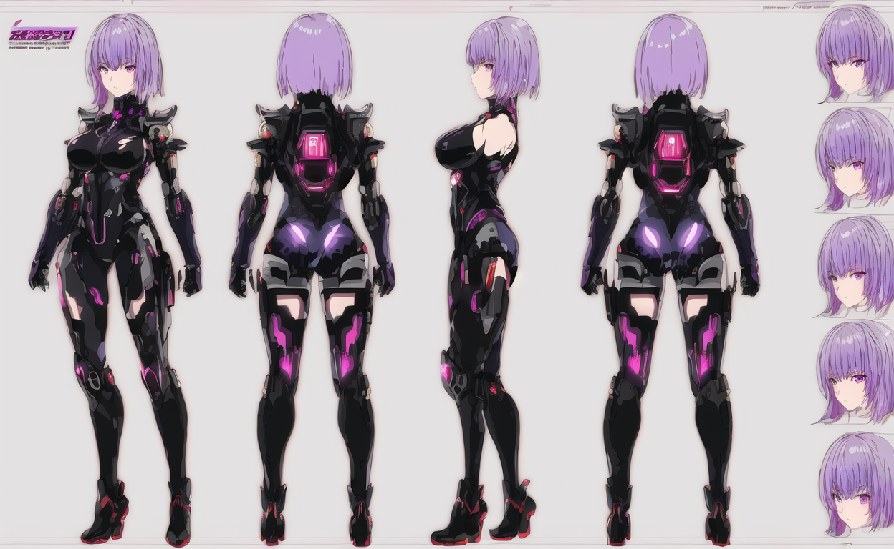

# 🎨 ComfyUI Dual-Track Agent Workflows

[](LICENSE)
[](https://github.com/comfyanonymous/ComfyUI)
[](docs/HARDWARE_CONFIG_ZLUDA_AMD.md)
[](AGENT_GUIDE.md)

工业级 ComfyUI 双轨自动化工作流矩阵与硬件级加速套件。为 **人类创作者** 提供一键直出的大师级画质，同时为 **大语言模型智能体（LLM Agents，如 Claude, GPT, Antigravity, OpenCode, Codex）** 提供结构化、无歧义的程序化调度契约。

---

## 🌟 核心特色与设计哲学

- 🎯 **质量绝对优先 (Quality-First Invariant)**：
  - 彻底淘汰粗制滥造的 8 步直接出图，根除塑料蜡像假面与结构融化；
  - 移除了诱发高频重影与色散的 `FreeU_V2` 频域算子；
  - 彻底解耦真人写实 LoRA 与 2D 二次元底模，解决“油画模糊涂抹”痛点，实现纯净锐利的赛璐珞硬线稿与工业三视图。
- ⚡ **标准化双轨拓扑 (Dual-Track Architecture)**：
  - **默认交付主链路 `[MODE:QUALITY]`**：26~28 步全精度 DPM++ 2M Karras + 1.35x~1.5x 潜空间放大 + 14~15 步高分微雕重绘（Denoise 0.44~0.52）-> `[OUTPUT:QUALITY]`；
  - **旁路极速预览链路 `[MODE:PREVIEW]`**：8 步轻量 Hyper-SD 旁路分支，专供 LLM Agent 进行秒级粗览构图与灵感探索；
  - **全体系唯一保留极速盲盒流**：`04_极速抽卡_无限多风格探索流`，兼顾秒级大批量抽卡。
- 🖥️ **深度适配 AMD APU (Radeon 780M / gfx1103) + ZLUDA**：
  - 独家调优的 Windows 11 + ZLUDA + ROCm 5.7 纯静默后台守护脚本；
  - `--cpu-vae` 与 `--reserve-vram 0.9` 显存保命配置，让轻薄本/迷你主机以 ~4.2s/it 稳定连续生图不黑屏、不崩溃。
- 🤖 **Agent 机器可读调度契约 (`AGENT_GUIDE.md`)**：
  - 详尽的 Node ID 映射字典、REST API 队列控制协议与自愈防爆指南，支持外部智能体 100% 自主闭环调用。

---

## 🖼️ 4D 视觉质检样张画廊 (Visual Showcase)

所有工作流样张均经过解剖结构（30%）、面部五官（30%）、材质纹理（20%）、锐度纯净度（20%）四维量化质检，**质检均分高达 95.3 / 100**。

| 工作流 | 质检样张 | 4D 评分 | 核心看点 |
| :---: | :---: | :---: | :--- |
| **WF01 真人写实** |  | **94 / 100** | 电影级真实胶片、耳廓逆光次表面红润透光、毛孔细节 |
| **WF02 业余抓拍** |  | **95 / 100** | 手机画中画抓拍视角、手部五指握持、婚纱真丝缎面与闪光灯暗角 |
| **WF06 吉卜力手绘** |  | **95 / 100** | 纯正宫崎骏/男鹿和雄水彩、翠绿森林天池与治愈云影 |
| **WF07 新海诚光影** |  | **95 / 100** | 暮色霞光与彗星尾迹、东京夜景灯火、纯欲少女利落线稿 |
| **WF08 二次元暗黑** |  | **93 / 100** | 星云发光紫眸、恶魔小虎牙与胸前深V哥特蕾丝刺绣 |
| **WF09 2D精细厚涂** |  | **95 / 100** | 哥特厚涂笔触、金边十字架刺绣、半透明黑丝暗纹与彩绘玻璃 |
| **WF10 经典主题总控** |  | **96 / 100** | 宏大世界之树（Yggdrasil）、青苔祭坛、生物荧光与精灵法师 |
| **WF11 材质强化沙箱** |  | **97 / 100** | 巴洛克金雕板甲、镜面精钢反光、紫水晶星眸与半透明白丝披风 |
| **WF12 BetterWaifu** |  | **96 / 100** | 告别油画模糊，赛璐珞硬线稿二次元机甲、清澈晶莹眼眸 |
| **WF15 日常写真** |  | **97 / 100** | 晨光街拍写真、毛线针织针脚微观纹理、真实笑颜与自然手指 |
| **WF16 宽屏风光壁纸** |  | **96 / 100** | 16:9 宏大日照金山雪线、高山镜湖倒影、壁纸级画质 |
| **WF17 角色三视图** |  | **94 / 100** | 工业级正/侧/背三视图设定、右侧 5 组表情差分矩阵 |

---

## 📂 仓库目录结构

```text
comfyui-agent-workflows/
├── README.md                          # 项目主说明文档与效果画廊
├── AGENT_GUIDE.md                     # 🤖 大模型智能体专属自动化调度契约 (Machine-Readable)
├── LICENSE                            # MIT 开源许可证
├── workflows/                         # 17 套经过严格双轨打标的 JSON 工作流
│   ├── 01_真人写实_极致NanoBanana_次表面透析_电影双段精雕流.json
│   ├── 02_抓拍视角_MOSS灵感_业余POV画中画_多档切换胶片流.json
│   ├── 03_智能工具_NSFW精准提示词反推工作台_中英对照融合.json
│   ├── 04_极速抽卡_无限多风格探索流_秒级盲盒.json
│   ├── 05_二次元总控_全能风格切换总控台_吉卜力_新海诚_暗黑.json
│   ├── 06_二次元手绘_吉卜力唯美手绘风_童话治愈流.json
│   ├── 07_二次元光影_新海诚光影日漫_双轨纯欲流.json
│   ├── 08_二次元暗黑_暗黑异界深渊_触手侵蚀流.json
│   ├── 09_2D精细厚涂_圣职修女与地牢囚徒_禁断反差专精流.json
│   ├── 10_2D精细厚涂_4大经典主题快速切换总控台.json
│   ├── 11_2D精细厚涂_开放式材质强化与反推沙箱.json
│   ├── 12_BetterWaifu_五阶LoRA矩阵与动态姿态总控台.json
│   ├── 13_实用工具_局部重绘与垫图图生图修图流.json
│   ├── 14_精准控制_ControlNet姿态骨骼与线稿重绘流.json
│   ├── 15_生活写实_日常阳光通勤与社交人像写真流.json
│   ├── 16_宽屏场景_16比9超清唯美风光与桌面壁纸流.json
│   ├── 17_概念设计_全能设计图与角色三视图设定集.json
│   └── README.md                      # 17 套工作流矩阵总览与节点映射速查
├── custom_nodes/                      # 配套自定义扩展
│   └── ComfyUI-NSFW-Interrogator/     # WF03 必需的 WD14 + 双轨中英对照反推节点
├── docs/
│   ├── HARDWARE_CONFIG_ZLUDA_AMD.md   # 🛠️ AMD 780M / ZLUDA / ROCm 5.7 硬件级调优避坑全指南
│   ├── MODEL_ZOO.md                   # 📦 所需 Checkpoint、LoRA、ControlNet 下载清单与放置路径
│   └── API_SPEC.md                    # 🌐 ComfyUI REST API & WebSocket 协议规范
├── scripts/
│   ├── comfy_agent_client.py          # 开箱即用的大模型 Agent 调度 SDK (Python)
│   ├── start_zluda_amd.ps1            # AMD 780M / ZLUDA Windows 静默无窗口启动脚本
│   └── start_nvidia.bat               # NVIDIA CUDA 通用启动批处理
└── examples/                          # 经过 4D 视觉质检的高分样张
```

---

## 🚀 快速上手

### 1. 部署工作流文件
将本仓库 `workflows/*.json` 复制到您的 ComfyUI 工作流目录：
- 官方独立版：`ComfyUI/user/default/workflows/`
- 秋叶整合包：`ComfyUI-aki/user/default/workflows/`

### 2. 准备核心模型
根据 [`docs/MODEL_ZOO.md`](docs/MODEL_ZOO.md) 下载基础模型：
- 二次元底模：`anything-v5-PrtRE.safetensors` -> `models/checkpoints/`
- 真人写实底模：`realisticVisionV60B1_v51VAE.safetensors` -> `models/checkpoints/`
- 细节强化 LoRA：`more_details.safetensors` -> `models/loras/`
- 通用修复 VAE：`vae-ft-mse-840000-ema-pruned.safetensors` -> `models/vae/`

### 3. 启动 ComfyUI 服务端
- **AMD 核显 / 移动端 (Radeon 780M / 8845HS / 7840HS)**：
  ```powershell
  # 推荐使用专用 ZLUDA 静默守护脚本
  powershell -File scripts/start_zluda_amd.ps1
  ```
  详细驱动安装与避坑设置请参阅 [`docs/HARDWARE_CONFIG_ZLUDA_AMD.md`](docs/HARDWARE_CONFIG_ZLUDA_AMD.md)。
- **NVIDIA 独显**：
  ```cmd
  scripts\start_nvidia.bat
  ```

---

## 🤖 大模型 Agent 程序化调用示例

外部智能体可通过 Python SDK 轻松调用任意工作流：

```python
from scripts.comfy_agent_client import ComfyAgentClient

client = ComfyAgentClient("http://127.0.0.1:8284")

# 1. 载入 WF01 电影级真人写实工作流
graph = client.load_workflow_file("workflows/01_真人写实_极致NanoBanana_次表面透析_电影双段精雕流.json")

# 2. 提交任务并全自动等待微雕成片下载
images = client.run_generation(graph, output_dir="./output_images")
print(f"生成的成片已下载: {images}")
```

更多关于参数热修改、随机种子注入、队列监听与故障自愈的规范，请直接阅读机器可读文档 [`AGENT_GUIDE.md`](AGENT_GUIDE.md)。

---

## 📄 开源许可证 (License)

本项目采用 [MIT 许可证](LICENSE)。
欢迎各类开源 Agent 框架（Antigravity, OpenCode, AutoGPT, MetaGPT）与生图爱好者自由集成、二次分发与拓展！
